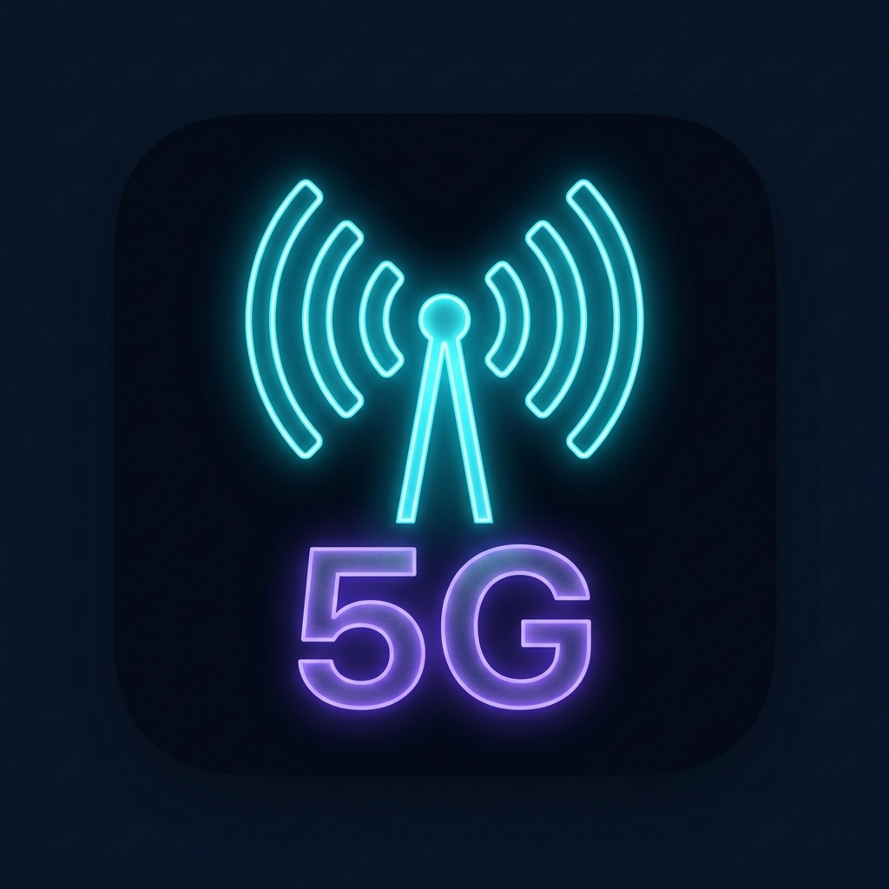

# 📱 5G Switch Pro — iOS Edition for Android

<p align="center">
  
</p>

<p align="center">
  <b>A god-level, ultra-fluid iOS Cupertino styled 5G/4G network mode switcher, live cell tower radar map, RF telemetry suite, and custom status bar icon changer for Android.</b>
</p>

<p align="center">
  
  
  
  
  
  
</p>

---

## 🌟 Key Highlights

- **⚡ 1-Click Automatic Mode Switching**:
  - Instantly lock network to **5G Only (NR SA)**, **5G/4G Auto (NR/LTE)**, **LTE Only**, or **Global (WCDMA/GSM)**.
  - Automatic background execution via **Shizuku API** or **Root Shell (`su`)**.
  - Built-in **Accessibility Auto-Pilot Service** that automatically triggers and selects the mode inside the hidden Android Radio Info menu (`*#*#4636#*#*`) with zero manual scrolling.

- **🏝️ Apple Dynamic Island**:
  - Live interactive floating island showing real-time 5G/LTE status, carrier name, live ICMP ping latency, and VoNR status.

- **📡 Real-Time Cell Tower Radar & Map**:
  - Rotating radar sweep canvas with concentric distance range rings (500m to 5km).
  - Displays nearby cell towers with **PCI (Physical Cell ID)**, **TAC (Tracking Area Code)**, **gNodeB Cell ID**, **RSRP signal strength**, **Azimuth bearing**, and **5G carrier aggregation bands** (e.g., n78, n28, b3).
  - 1-Tap Google Maps **Directions** button to navigate straight to any tower.

- **🎨 Status Bar Icon Customizer**:
  - Change the indicator shown on your device's top status bar:
    - 📶 **5G Ultra Wideband**
    - 📶 **4G LTE**
    - 🗼 **Antenna Tower**
    - ⚡ **Lightning Bolt**
    - 🏎️ **Speedometer Gauge**
    - 🍏 **Apple iOS Logo**

- **📊 Deep RF Telemetry & Speed/Ping Engine**:
  - Live RSRP, RSRQ, SINR, ASU, Link Speeds, and Signal Bars.
  - Real-time continuous ICMP socket ping waveform canvas with Min/Max/Avg latency and jitter calculation.

- **🎛️ Control Center Quick Tiles**:
  - iOS-style Control Center grid for Radio Info, APN configurations, SIM management, and Wi-Fi 6 telemetry.

---

## 🛠️ Architecture & Tech Stack

```
5G-Switch-Pro/
├── app/
│   ├── src/main/java/com/example/
│   │   ├── MainActivity.kt               # Edge-to-edge Compose root & navigation
│   │   ├── model/
│   │   │   └── NetworkModels.kt          # Telemetry, cell tower & network mode models
│   │   ├── service/
│   │   │   ├── NetworkTelemetryManager.kt# Telephony, Wi-Fi & ICMP ping manager
│   │   │   ├── RootNetworkController.kt  # Shizuku reflection & root shell controller
│   │   │   ├── StatusBarIconService.kt   # Persistent status bar icon manager
│   │   │   ├── RadioInfoAccessibilityService.kt # 1-click automatic mode picker
│   │   │   └── IntentLauncher.kt         # Secret intent & settings launcher
│   │   └── ui/
│   │       ├── components/               # iOS Dynamic Island, Cupertino switches, Cards
│   │       ├── screens/                  # Dashboard, Tower Map, Telemetry, Ping, Settings
│   │       └── theme/                    # iOS dark/light glassmorphic styling
│   └── src/main/res/
│       ├── drawable/                     # Custom vector icons & adaptive launcher assets
│       └── xml/                          # Accessibility & backup configurations
└── build.gradle.kts                      # Gradle Kotlin DSL with modern Version Catalog
```

- **Framework**: Jetpack Compose (100% Kotlin DSL)
- **State Management**: Kotlin Coroutines & `StateFlow`
- **Networking & Diagnostics**: Raw Socket ICMP Ping & Android `TelephonyManager`
- **Shell & Privilege Execution**: Shizuku API (v13.1.5) & Superuser root hooks

---

## 🚀 How to Build & Run

### Prerequisites
- Android Studio Ladybug / Meerkat (or newer)
- JDK 17 or JDK 21
- Android SDK 34+ (Target SDK 36)

### 1. Clone the repository
```bash
git clone https://github.com/<your-username>/5g-switch-pro.git
cd 5g-switch-pro
```

### 2. Build Debug APK
On Linux / macOS:
```bash
./gradlew assembleDebug
```
On Windows:
```cmd
gradlew.bat assembleDebug
```

The APK will be generated at:
`app/build/outputs/apk/debug/app-debug.apk`

### 3. Install on your device
```bash
adb install -r app/build/outputs/apk/debug/app-debug.apk
```

---

## 🔑 Permissions & Shizuku Setup

| Permission | Purpose |
| :--- | :--- |
| `READ_PHONE_STATE` | Read real-time cellular network type (5G / 4G) and signal strength |
| `ACCESS_FINE_LOCATION` | Required by Android Telephony API to identify nearby cell towers |
| `POST_NOTIFICATIONS` | Displays the chosen custom status bar icon |
| `INTERNET` | Live socket latency and continuous ping diagnostic tests |
| `moe.shizuku.manager.permission.API_V23` | Seamless 1-click mode switching without manual touch interaction |

> **Tip for Non-Rooted Users**: Install the [Shizuku app](https://shizuku.rikka.app/) from Google Play or GitHub and start it once via Wireless Debugging (ADB). 5G Switch Pro will automatically link with Shizuku to execute instant network switches in the background.

---

## 📄 License

This project is licensed under the [MIT License](LICENSE).
